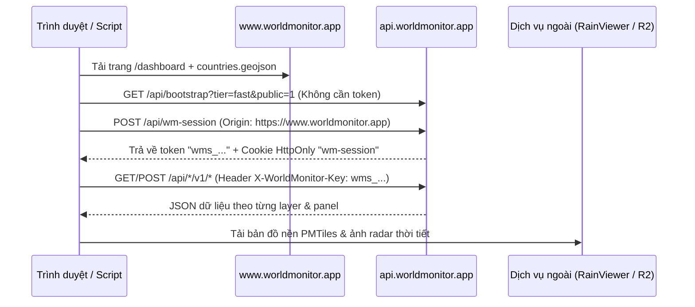

# Báo cáo Hệ thống API — World Monitor (`worldmonitor.app`)

Tài liệu này tổng hợp toàn bộ các API endpoint, cơ chế xác thực, tham số truy vấn và cấu trúc dữ liệu trả về được thu thập trực tiếp từ phiên làm việc của trang:
`https://www.worldmonitor.app/dashboard?zoom=1.00&view=global&timeRange=7d&layers=iranAttacks,hotspots,conflicts,bases,nuclear,military,weather,canadaAlerts,outages,natural,waterways,economic,sanctions` (bao gồm cả các request kích hoạt khi phóng to bản đồ lên `zoom >= 3` cho các layer giới hạn mức thu phóng).

> [!TIP]
> World Monitor là dự án mã nguồn mở có sẵn đặc tả OpenAPI 3.1 công khai tại https://www.worldmonitor.app/openapi.json và mã nguồn tại https://github.com/koala73/worldmonitor. Bạn không cần dịch ngược thủ công toàn bộ schema nếu muốn sinh SDK tự động.

---

## 1. Kiến trúc Giao tiếp & Cơ chế Xác thực

 Toàn bộ API chính của hệ thống đặt tại tên miền `https://api.worldmonitor.app` (chủ yếu qua HTTPS REST/JSON RPC; không dùng WebSocket trên bản web công khai).



### 3 Chế độ Gọi API

1. **Endpoint công khai hoàn toàn (`public=1`, `bootstrap`, `product-catalog`, GeoJSON tĩnh):**
   - Không cần API key, không cần cookie phiên (`Access-Control-Allow-Origin: *`).
2. **Session Token ẩn danh của trình duyệt (`wms_...`) — Không cần đăng nhập:**
   - Khi mở dashboard, web app gọi `POST https://api.worldmonitor.app/api/wm-session` (body rỗng, header `Origin: https://www.worldmonitor.app`).
   - Server trả về token có chữ ký `wms_<base64url_payload>.<hmac_sig>` (hiệu lực 12 giờ, `Max-Age=43200`) kèm cookie `wm-session`.
   - Các request tiếp theo gửi kèm header:
     - `X-WorldMonitor-Key: wms_<payload>.<sig>`
     - `Cookie: wm-session=wms_...`
     - `Origin: https://www.worldmonitor.app` và `Referer: https://www.worldmonitor.app/`
   - Giới hạn tốc độ (Rate limit): `600 requests / 60 giây` (`RateLimit-Limit: 600`).
3. **API Key chính thức cho Developer / SDK / MCP (`wm_...`):**
   - Khi tích hợp bên ngoài trình duyệt vào các route `/api/*/v1/*` không có `public=1`, hệ thống hỗ trợ khóa `X-WorldMonitor-Key: wm_<40-hex>`.
   - Mọi endpoint `GET` đều hỗ trợ tham số `?jmespath=<biểu_thức>` để lọc JSON ngay phía server, và gom tối đa 20 lệnh `GET` qua `POST https://api.worldmonitor.app/api/batch/v1/execute`.

> [!IMPORTANT]
> Khi gọi API bằng script (`curl`, Python `requests`/`httpx`, Node.js), **luôn đặt header `User-Agent` rõ ràng** (ví dụ `Mozilla/5.0 ...` hoặc `my-research-tool/1.0`). Các `User-Agent` mặc định như `python-requests/*` hoặc `curl/*` có thể bị tường lửa Cloudflare chặn với mã `403`.

---

## 2. Ánh xạ 13 Layer trên URL sang API Endpoint

| Layer trên URL | Tên hiển thị UI | Cơ chế tải dữ liệu | Endpoint API / Nguồn dữ liệu chính |
| :--- | :--- | :--- | :--- |
| `iranAttacks` | Middle East Strikes | Gộp qua `bootstrap` + RPC xung đột & cảnh báo | `GET /api/bootstrap?tier=fast&public=1`, `GET /api/conflict/v1/list-iran-events`, `GET /api/oref-alerts` |
| `hotspots` | Intel Hotspots | Tọa độ tĩnh kết hợp chấm điểm tin tức & tín hiệu nóng | Bundle tĩnh `gdelt-intel-*.js` + `GET /api/news/v1/list-feed-digest?variant=full&lang=en&public=1` + `GET /api/intelligence/v1/get-pizzint-status?include_gdelt=true` |
| `conflicts` | Conflict Zones | Đa giác tĩnh + dữ liệu sự kiện chiến sự trực tiếp | Bundle `geo-map-data-*.js` + `GET /api/conflict/v1/list-acled-events` + `GET /api/conflict/v1/list-ucdp-events` |
| `bases` | Military Bases (`zoom >= 3`) | Truy vấn theo khung nhìn bản đồ (bounding box) khi phóng to | `GET /api/military/v1/list-military-bases?ne_lat=...&ne_lon=...&sw_lat=...&sw_lon=...&zoom=...` |
| `nuclear` | Nuclear Sites (`zoom >= 3.5`) | Dữ liệu tĩnh đóng gói sẵn trong bundle | Mảng tĩnh trong `/assets/geo-map-data-*.js` (`{id, name, lat, lon, type, status, operator}`) |
| `military` | Military Activity | Máy bay quân sự ADS-B phân trang + tra cứu ICAO24 + tàu AIS | `GET /api/military/v1/list-military-flights`, `POST /api/military/v1/get-aircraft-details-batch`, `GET /api/maritime/v1/get-vessel-snapshot?include_candidates=true`, `GET /api/intelligence/v1/get-gdelt-topic-timeline?topic=military` |
| `weather` | Weather Alerts | Cảnh báo qua `bootstrap` + radar thời tiết RainViewer + biển IMD | `GET /api/bootstrap?tier=fast&public=1`, `GET /api/bootstrap?keys=imdCycloneMarine&public=1`, `GET https://api.rainviewer.com/public/weather-maps.json` |
| `canadaAlerts` | Canada Alerts | Gộp trong `bootstrap` từ hệ thống khẩn cấp các bang Canada | `GET /api/bootstrap?tier=fast&public=1` (Alberta, BC, SaskAlert) |
| `outages` | Internet Disruptions | Gộp trong `bootstrap` + RPC sự cố hạ tầng (Cloudflare Radar) | `GET /api/bootstrap?tier=fast&public=1`, `GET /api/infrastructure/v1/list-internet-outages` |
| `natural` | Natural Events | Động đất USGS, thiên tai GDACS & NASA EONET | `GET /api/bootstrap?tier=fast&public=1` (`data.earthquakes`, ...), `GET /api/natural/v1/list-natural-events` |
| `waterways` | Chokepoints | Trạng thái 13 eo biển/kênh đào huyết mạch toàn cầu | `GET /api/supply-chain/v1/get-chokepoint-status` |
| `economic` | Economic Centers (`zoom >= 3`) | Dữ liệu trung tâm tài chính tĩnh + chuỗi vĩ mô & thị trường | Bundle `finance-geo-*.js` + `GET /api/bootstrap?tier=slow&public=1` + `/api/economic/v1/*` + `/api/market/v1/*` |
| `sanctions` | Sanctions | Đường biên giới GeoJSON + dòng thời gian trừng phạt GDELT & RPC | `GET https://www.worldmonitor.app/data/countries.geojson` + `GET /api/intelligence/v1/get-gdelt-topic-timeline?topic=sanctions` + `/api/sanctions/v1/*` |

---

## 3. Chi tiết các Endpoint Chính trên `https://api.worldmonitor.app`

### 3.1 Nhóm Khởi tạo Phiên, Bootstrap & Hệ thống

| Method & Path | Tham số / Body | Xác thực | Dữ liệu trả về tiêu biểu |
| :--- | :--- | :--- | :--- |
| `POST /api/wm-session` | Body rỗng | Công khai (cần `Origin: https://www.worldmonitor.app`) | `{"ok": true, "exp": ..., "hadSession": true, "token": "wms_..."}` |
| `GET /api/bootstrap` | `?tier=fast&public=1`<br>`?tier=slow&public=1`<br>`?keys=liveVideoResolved&public=1`<br>`?keys=imdCycloneMarine&public=1`<br>`?keys=forecasts&public=1`<br>`?keys=cbrRates&public=1`<br>`?keys=marketCorrelationSeries&public=1`<br>`?keys=spending` (cần key) | Công khai khi có `public=1` | `{"data": {...}, "missing": []}` — chứa động đất USGS, thời tiết/bão, đứt cáp/mất mạng, dòng vốn ETF (`IBIT`, `FBTC`...), lãi suất BIS/CBR, dự báo AI (`forecasts`), hợp đồng chính phủ Mỹ (`spending`) |
| `GET /api/product-catalog` | Không | Công khai | Thông tin gói cước, giới hạn gói và thống kê hệ thống (`mapLayers: 61`, `feedDefinitions: 1351`, `mcpTools: 100`) |
| `GET /api/correlation-runtime-mode` | Không | `X-WorldMonitor-Key` | `{"mode": "legacy"}` |
| `GET /api/health` | `?compact=1` | Công khai / Session | Trạng thái hoạt động của 430 nguồn dữ liệu (`summary`, `problems`, `pending`) |
| `POST /api/analytics-health` | JSON thống kê client | `X-WorldMonitor-Key` | `204 No Content` |

### 3.2 Nhóm Xung đột, Cảnh báo Tên lửa, Phá sóng GPS & OSINT

| Method & Path | Tham số / Body | Xác thực | Dữ liệu trả về tiêu biểu |
| :--- | :--- | :--- | :--- |
| `GET /api/conflict/v1/list-acled-events` | `start`, `end`, `page_size`, `cursor`, `country` (tùy chọn) | `X-WorldMonitor-Key` | `{"events": [...], "pagination": {...}}` — dữ liệu xung đột, biểu tình, bạo động từ ACLED |
| `GET /api/conflict/v1/list-ucdp-events` | `start`, `end`, `page_size`, `cursor`, `country` (tùy chọn) | `X-WorldMonitor-Key` | `{"events": [{"id", "dateStart", "location", "country", "sideA", "sideB", "deathsBest", "violenceType"}]}` |
| `GET /api/conflict/v1/list-iran-events` | Tùy chọn bộ lọc thời gian | `X-WorldMonitor-Key` | Danh sách sự kiện tấn công/đối đầu tại Trung Đông (`iranAttacks`) |
| `GET /api/oref-alerts` | Không (poll mỗi ~60s) | `X-WorldMonitor-Key` | `{"configured": true, "alerts": [...], "historyCount24h": 0}` — cảnh báo tên lửa/rocket thời gian thực tại Israel (Pikud HaOref) |
| `GET /api/gpsjam` | Không | Công khai / Session | Danh sách ô lưới H3 bị nhiễu/phá sóng GPS hàng không (`{"h3", "lat", "lon", "level", "region", "pct", "affectedAircraft"}`) |
| `GET /api/telegram-feed` | `?limit=50` | `X-WorldMonitor-Key` | Tin tức OSINT chọn lọc từ Telegram (`channel`, `text`, `topic`, `tags`, `earlySignal`, `mediaUrls`) |
| `GET /api/x-feed` | `?limit=50` | `X-WorldMonitor-Key` | Bài đăng OSINT từ X/Twitter (`account`, `text`, `topic`, `tags`, `earlySignal`) |

### 3.3 Nhóm Quân sự, Hàng hải & Chuỗi cung ứng (`bases`, `military`, `waterways`)

| Method & Path | Tham số / Body | Xác thực | Dữ liệu trả về tiêu biểu |
| :--- | :--- | :--- | :--- |
| `GET /api/military/v1/list-military-bases` | `ne_lat`, `ne_lon`, `sw_lat`, `sw_lon`, `zoom` (+ `type`, `kind`, `country`) | `X-WorldMonitor-Key` | Danh sách căn cứ quân sự, sân bay, quân cảng trong khung nhìn (`kind`, `countryIso2`, `type: "us-nato"`, `branch`) |
| `GET /api/military/v1/list-military-flights` | `ne_lat=90&ne_lon=180&sw_lat=-90&sw_lon=-180&operator=&aircraft_type=&cursor=...` | `X-WorldMonitor-Key` | `{"flights": [{"callsign", "hexCode", "registration", "aircraftModel", "operator", "location", "altitude", "heading", "speed", "source": "adsb.lol"}]}` |
| `POST /api/military/v1/get-aircraft-details-batch` | `{"icao24s": ["06a00f", ...]}` | `X-WorldMonitor-Key` | Thông tin chi tiết chủng loại, số serial, đơn vị vận hành của từng mã ICAO24 |
| `GET /api/military/v1/get-wingbits-status` | Không | `X-WorldMonitor-Key` | `{"configured": true}` |
| `GET /api/maritime/v1/get-vessel-snapshot` | `?include_candidates=true` (+ `ne_lat`, `sw_lat`, `include_tankers`) | `X-WorldMonitor-Key` | Vị trí tàu hải quân/tàu nghi vấn AIS và mật độ lưu thông tại các vùng biển (`vessels`, `densityZones`) |
| `GET /api/supply-chain/v1/get-chokepoint-status` | Không | `X-WorldMonitor-Key` | Điểm gián đoạn, cảnh báo hàng hải, mức tắc nghẽn và rủi ro chiến tranh tại 13 điểm nghẽn hàng hải (Hormuz, Bab el-Mandeb, Suez, Malacca, Đài Loan...) |
| `GET /api/supply-chain/v1/get-china-corridor-control-towers` | Không | `X-WorldMonitor-Key` | Tín hiệu hành lang vận tải biển & cảng từ IMF PortWatch |

### 3.4 Nhóm Tình báo, Tin tức, Di cư & Dự báo AI

| Method & Path | Tham số / Body | Xác thực | Dữ liệu trả về tiêu biểu |
| :--- | :--- | :--- | :--- |
| `GET /api/intelligence/v1/get-pizzint-status` | `?include_gdelt=true` | `X-WorldMonitor-Key` | Chỉ số Pentagon Pizza (`defconLevel`) và điểm căng thẳng song phương `tensionPairs` (`usa_iran`, `iran_gcc` kèm bằng chứng trừng phạt/không kích) |
| `GET /api/intelligence/v1/get-gdelt-topic-timeline` | `?topic=military`, `?topic=sanctions` | `X-WorldMonitor-Key` | Chuỗi thời gian tần suất/sắc thái GDELT cập nhật mỗi 15 phút (`[{date, value}]`) |
| `GET /api/news/v1/list-feed-digest` | `?variant=full&lang=en&public=1` | Công khai (`public=1`) | Tin tức toàn cầu tổng hợp từ hơn 745 nguồn chia theo 18 danh mục, kèm điểm mức độ đe dọa (`threat`, `importanceScore`, `credibilityScore`) |
| `GET /api/news/v1/list-source-items` | `editions=full&lang=en&category={us\|europe\|middleeast\|ai\|crisis\|asia\|intel...}&sources=...` | `X-WorldMonitor-Key` | Danh sách bài báo chi tiết theo từng khu vực/chuyên đề |
| `GET /api/news/v1/summarize-article-cache` | `?cache_key=summary:...` | `X-WorldMonitor-Key` | Bản tóm tắt tình hình bằng LLM đã lưu cache |
| `GET /api/infrastructure/v1/list-temporal-anomalies` | Không | `X-WorldMonitor-Key` | Phát hiện bất thường Z-score trên luồng tin tức, cháy rừng vệ tinh, chuyến bay quân sự, tàu thuyền và mất tín hiệu AIS |
| `GET /api/displacement/v1/get-displacement-summary` | `?flow_limit=50&public=1` | Công khai (`public=1`) | Thống kê người tị nạn & di dời nội địa từ UNHCR / UN OCHA (`countries`, `flows`) |
| `GET /api/forecast/v1/get-simulation-outcome` | Không | `X-WorldMonitor-Key` | Kịch bản mô phỏng leo thang, kiềm chế và tác động dây chuyền lên thị trường |
| `GET /api/forecast/v1/get-forecast-scorecard` | Không | `X-WorldMonitor-Key` | Lịch sử độ chính xác (Brier score) của các dự báo AI |

### 3.5 Nhóm Kinh tế Vĩ mô & Thị trường Tài chính (`economic`)

| Method & Path | Tham số / Body | Xác thực | Dữ liệu trả về tiêu biểu |
| :--- | :--- | :--- | :--- |
| `POST /api/economic/v1/get-fred-series-batch` | `{"seriesIds": ["VIXCLS", "FEDFUNDS", "T10Y2Y", "UNRATE", "CPIAUCSL", "DGS10", ...], "limit": 120}` | `X-WorldMonitor-Key` | Chuỗi dữ liệu kinh tế Mỹ từ Cục Dự trữ Liên bang (FRED) |
| `GET /api/economic/v1/get-bls-series` | `?series_id=USPRIV&limit=60`, `?series_id=ECIALLCIV&limit=60` | `X-WorldMonitor-Key` | Số liệu việc làm & chi phí lao động từ Cục Thống kê Lao động Mỹ (BLS) |
| `GET /api/economic/v1/get-ecb-fx-rates` | Không | `X-WorldMonitor-Key` | Tỷ giá ngoại hối từ Ngân hàng Trung ương Châu Âu (`EURUSD`, ...) |
| `GET /api/economic/v1/get-energy-prices` | Không | `X-WorldMonitor-Key` | Giá dầu thô giao ngay WTI & Brent từ EIA (đơn vị `$/barrel`) |
| `GET /api/economic/v1/get-china-activity-nowcast` | Không | `X-WorldMonitor-Key` | Chỉ số hoạt động công nghiệp & vận tải biển Trung Quốc (CCFI + PortWatch) |
| `GET /api/market/v1/list-market-quotes` | `?symbols=^GSPC&symbols=NVDA...` | `X-WorldMonitor-Key` | Giá cổ phiếu & chỉ số chứng khoán toàn cầu kèm biểu đồ sparkline trong ngày |
| `GET /api/market/v1/list-crypto-quotes` | Không | `X-WorldMonitor-Key` | Giá tiền mã hóa (`BTC`, `ETH`, `SOL`, ...) kèm biến động 24h/7d |

---

## 4. Dữ liệu Bản đồ Tĩnh, API Bên thứ ba & Các RPC Mở rộng

### GeoJSON & Dịch vụ Bên thứ ba
- **Ranh giới quốc gia (`sanctions` & choropleth):**
  - `GET https://www.worldmonitor.app/data/countries.geojson` (Công khai, `CORS: *`)
  - `GET https://maps.worldmonitor.app/country-boundary-overrides.geojson`
- **Radar thời tiết trực tiếp (`weather`):**
  - `GET https://api.rainviewer.com/public/weather-maps.json` → lấy `frameHash` mới nhất.
  - `GET https://tilecache.rainviewer.com/v2/radar/{frameHash}/256/{z}/{x}/{y}/6/1_1.png` → ảnh PNG lớp phủ mưa/bão theo tọa độ ô bản đồ.
- **Bản đồ nền Vector (Protomaps PMTiles trên Cloudflare R2):**
  - `GET https://pub-8ace9f6a86d74cb2bd5eb1de5590dd9e.r2.dev/planet.pmtiles` (HTTP `Range` trả về `206 Partial Content`).
- **Luồng Video Tin tức Trực tiếp:**
  - `GET https://www.bloomberg.com/media-manifest/streams/us.m3u8` (HLS `.m3u8` / `.ts`).

### Các RPC Khác có sẵn trong Bundle (Gọi khi bật thêm Layer / Panel)
Ngoài các request tự động chạy khi tải URL trên, client còn định nghĩa sẵn nhiều dịch vụ dưới `https://api.worldmonitor.app`:
- **Hạ tầng & Mạng:** `GET /api/infrastructure/v1/list-internet-outages`, `get-cable-health`, `list-internet-ddos-attacks`, `list-internet-traffic-anomalies`, `reverse-geocode`, `search-place`
- **Quân sự & Hàng hải chuyên sâu:** `GET /api/military/v1/get-theater-posture`, `get-usni-fleet-report`, `list-ukmto-incidents`, `list-navigational-warnings`
- **Tình báo Quốc gia & Vệ tinh:** `GET /api/intelligence/v1/get-risk-scores`, `get-country-risk`, `get-country-intel-brief`, `list-satellites`, `list-gps-interference`, `search-gdelt-documents`
- **Năng lượng, Đường ống & Khoáng sản:** `GET /api/supply-chain/v1/list-pipelines`, `list-storage-facilities`, `get-critical-minerals`, `get-shipping-rates`
- **Thiên tai, An ninh mạng, Khí hậu, Hàng không & Webcam:** `/api/natural/v1/list-natural-events`, `/api/cyber/v1/list-cyber-threats`, `/api/climate/v1/list-reservoir-levels`, `/api/aviation/v1/list-aircraft-emergencies`, `/api/webcam/v1/list-webcams`

---

## 5. Tài liệu Chính thức & Ví dụ Gọi Thử

### Liên kết Tài liệu của World Monitor
- **OpenAPI 3.1 (JSON / YAML):** https://www.worldmonitor.app/openapi.json | https://www.worldmonitor.app/openapi.yaml
- **Trang tài liệu API:** https://www.worldmonitor.app/docs/documentation
- **Hướng dẫn xác thực & giới hạn:** https://www.worldmonitor.app/docs/usage-auth
- **Sandbox miễn phí không cần key:** https://www.worldmonitor.app/sandbox/index.json
- **MCP Server:** `https://worldmonitor.app/mcp` (Tài liệu: https://www.worldmonitor.app/docs/mcp)
- **GitHub (AGPL-3.0):** https://github.com/koala73/worldmonitor

### Ví dụ Gọi Nhanh bằng `curl`

**1. Gọi trực tiếp endpoint công khai (`public=1`, không cần token):**
```bash
curl -sS -A "Mozilla/5.0 (Macintosh; Intel Mac OS X 10_15_7)" \
  "https://api.worldmonitor.app/api/bootstrap?tier=fast&public=1" | head -c 500
```

**2. Lấy session token `wms_...` như trình duyệt để gọi các endpoint layer (ví dụ: máy bay quân sự hoặc eo biển hàng hải):**
```bash
TOKEN=$(curl -sS -X POST "https://api.worldmonitor.app/api/wm-session" \
  -H "User-Agent: Mozilla/5.0 (Macintosh; Intel Mac OS X 10_15_7)" \
  -H "Origin: https://www.worldmonitor.app" \
  -H "Content-Type: application/json" | python3 -c "import sys,json; print(json.load(sys.stdin)['token'])")

curl -sS "https://api.worldmonitor.app/api/supply-chain/v1/get-chokepoint-status" \
  -H "User-Agent: Mozilla/5.0 (Macintosh; Intel Mac OS X 10_15_7)" \
  -H "Origin: https://www.worldmonitor.app" \
  -H "Referer: https://www.worldmonitor.app/" \
  -H "X-WorldMonitor-Key: $TOKEN"
```
